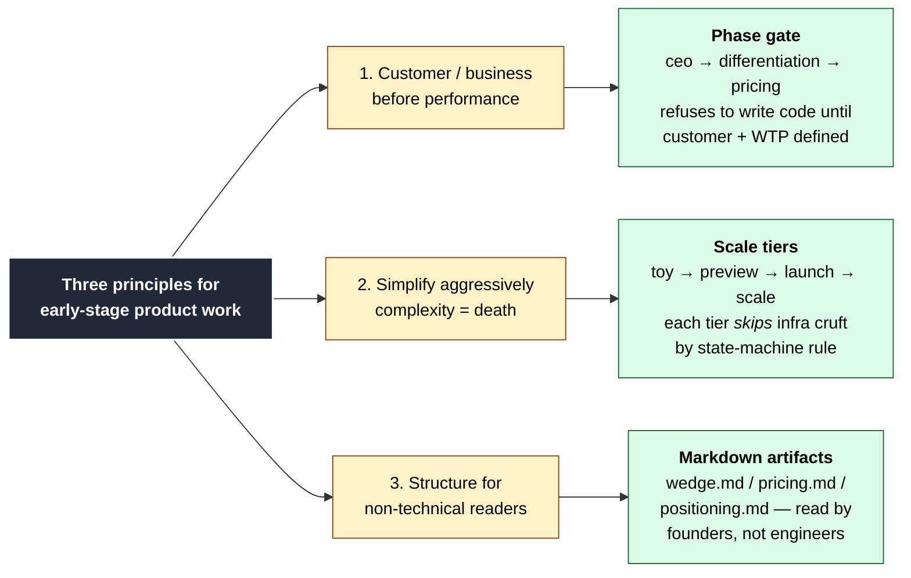
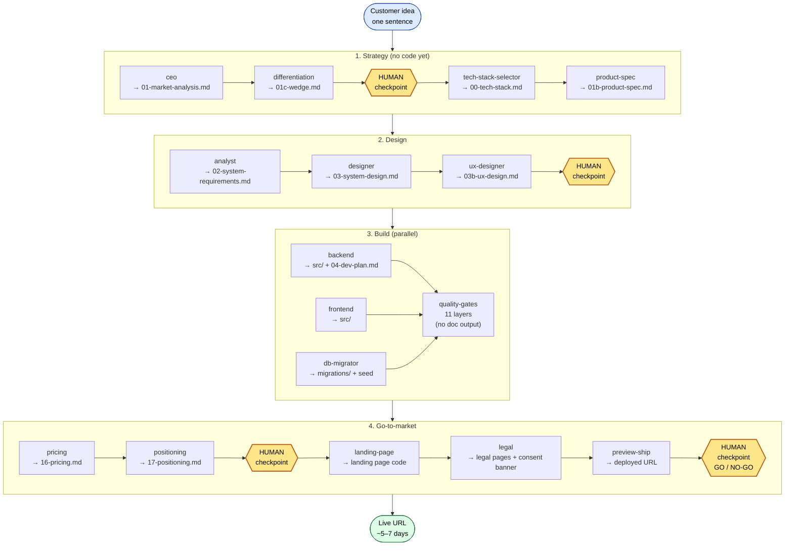
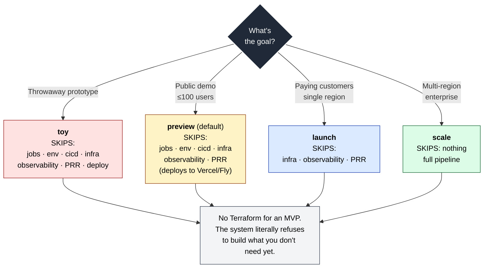
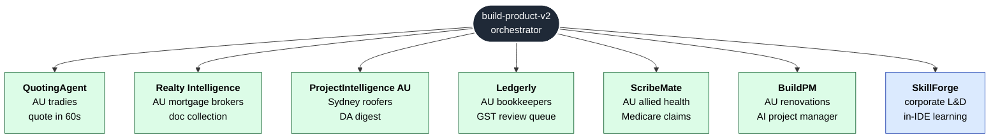
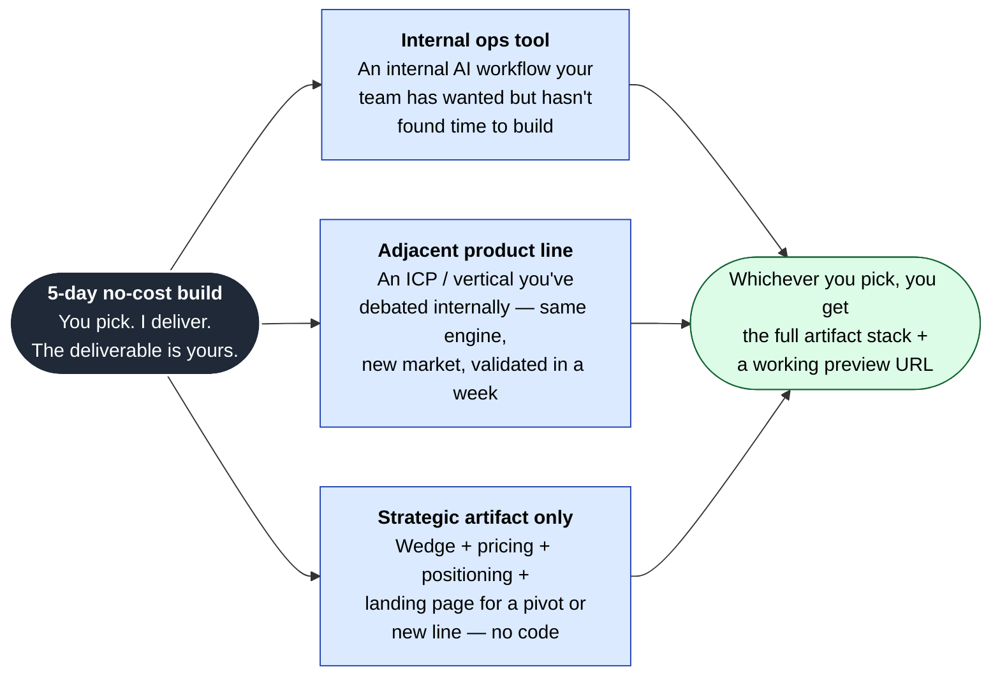
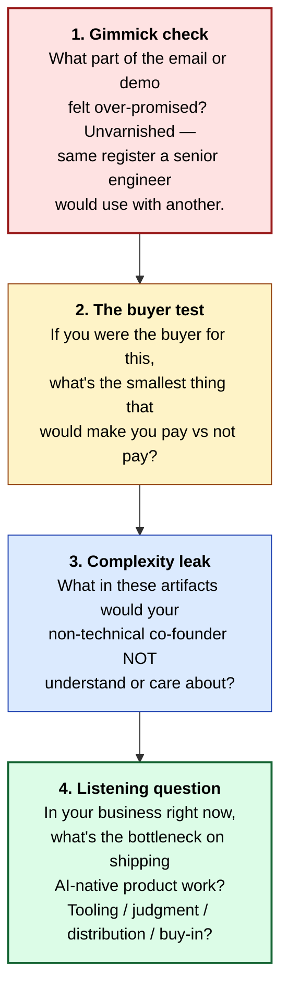
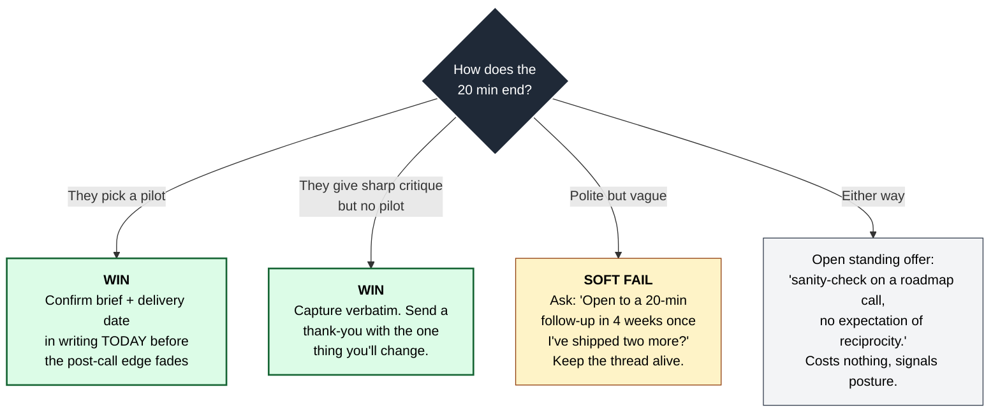

# CEO's 20 MINUTES — Visual Meeting Deck

**Generic 20-min intro for an early-stage CEO / founder.**
Screen-share this doc. Each section is one talking beat.

> Before the call: swap in (a) the founder's name, (b) one specific
> reference from their recent public writing, (c) two or three pilot
> options shaped to their actual product/market.

---

## Topic 1 — Three principles, built into the architecture

The orchestrator is opinionated about what early-stage product work
actually rewards. Three constraints, each enforced by the system itself.

**Narration (30s):** "Three principles, each one a hard constraint in the
system, not a vibe. I'll walk you through one example and then I want
your read on whether it actually delivers what those principles point at."

---

## Topic 2 — What the orchestrator does, in one picture

**Narration (45s):** "Idea in, deployed product out. Four phases. Each
arrow has a critic skill on a different model than the producer — that's
the slop guard. The yellow boxes are non-skippable human checkpoints.
Nothing auto-ships past a human 'no'."

---

## Topic 3 — Simplicity is a state-machine rule, not a vibe

The single most important diagram for an early-stage CEO — the system
literally refuses to over-build.

**Narration (30s):** "Most engineers default to launch-tier infra for a
toy. The orchestrator won't let me. The default is *preview* — the
cheapest thing that still proves customer demand. That's an architectural
constraint, not a discipline I have to remember."

---

## Topic 4 — Seven products already shipped through it

Proof it's not a slide deck.

**Narration (20s):** "Each one has the full artifact stack: wedge,
pricing, positioning, landing page, deployed app. Pick whichever is
closest to your domain — I'll walk through that one's artifacts in
90 seconds."

> **Pre-call task:** pre-load the artifact tabs for the ONE product
> closest to the founder's market. Don't ask them to choose live —
> momentum matters.

---

## Topic 5 — The offer, made concrete

Don't leave the 5-day pilot abstract. Make them pick.

**Narration (45s):** "Three shapes. Pick the one that's most useful to
you internally. No sales pitch attached — the deliverable is yours
either way. If none of these fit, tell me which problem in your business
would, and I'll come back with a v2."

> **Pre-call task:** sharpen these three options against the founder's
> actual product / roadmap. Generic options land generic.

---

## Topic 6 — The four questions you actually want answered

Lead with the bluntest first while there's still time to dig in.

**Order matters.** Bluntest first — there's still time to dig into the
answer. Question 4 is the one with the most asymmetric value (intelligence
about the founder's actual constraint right now).

---

## Topic 7 — Time budget (don't overrun any block)

```mermaid
gantt
    title 20-minute meeting plan
    dateFormat  mm
    axisFormat %M

    section Land
    Permission to drive            :a1, 00, 1m

    section Show
    Topic 1 — three principles     :a2, after a1, 1m
    Topic 2 — pipeline picture     :a3, after a2, 2m
    Topic 3 — scale tiers          :a4, after a3, 1m
    Topic 4 — seven products       :a5, after a4, 1m

    section Offer
    Topic 5 — pick a pilot         :a6, after a5, 5m

    section Feedback
    Topic 6 — four questions       :a7, after a6, 6m

    section Close
    One decision + one open door   :a8, after a7, 3m
```

If anything overruns, **cut Topic 4** (the seven-products slide). The
offer and the feedback questions are non-negotiable.

---

## Topic 8 — Decision tree for how the call ends

---

## One-line reminders

| Do | Don't |
|---|---|
| Ask permission to drive the 20 min in the first 60 seconds | Re-narrate context the founder already has |
| Show the artifact stack (markdown), not the code | Screen-share the IDE for non-technical founders |
| Reference one specific phrase from their recent writing | Generic "your AI post" — sounds skimmed |
| Send the follow-up one-pager within 30 min of hangup | Wait until tomorrow — momentum dies |
| Hold founder-to-founder posture, not applicant | Bring up any prior rejection or rejection-shaped history |

---

## Final check before you join the call

- [ ] This doc open in tab 1, ready to screen-share
- [ ] Best-fit product's artifact stack open in tabs 2–5
- [ ] Founder's most recent public post open in tab 6 — note the **exact phrase** you'll quote
- [ ] Their company site open in tab 7 — for the pilot-pitch sharpening
- [ ] Three pilot options sharpened against their actual product / roadmap
- [ ] Mic / camera / share tested
- [ ] Follow-up one-pager template open in a draft email, ready to fill and send
