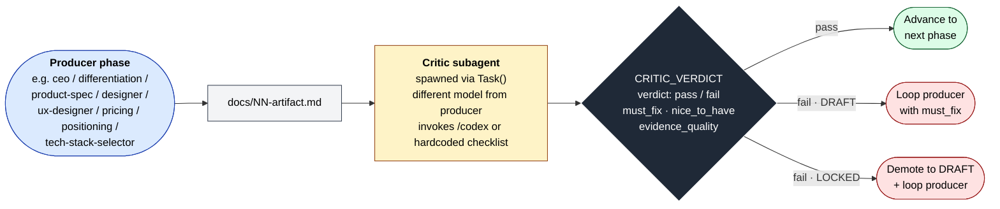
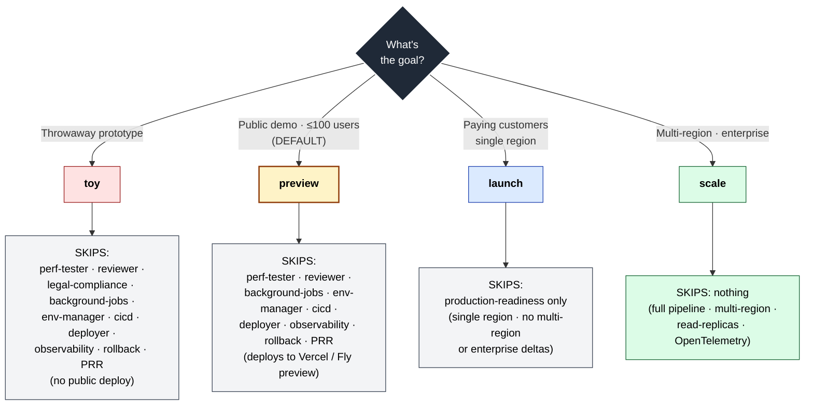
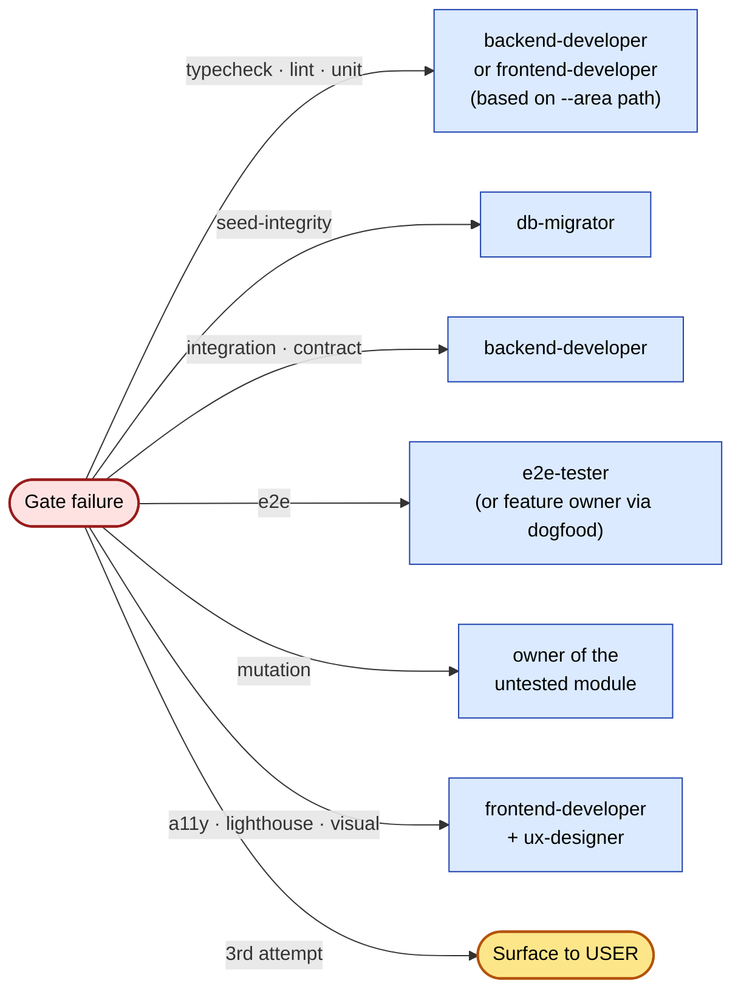
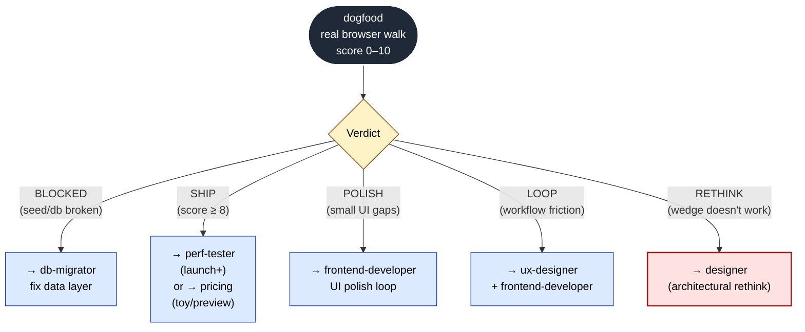
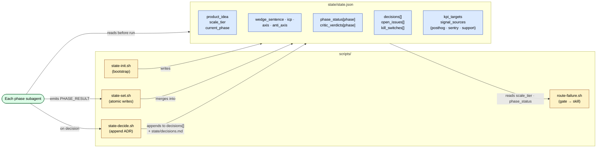

# build-product-v2 — Orchestrator Workflow (Verified)

Source-of-truth diagrams of the orchestrator at
`.claude/skills/build-product-v2/`. Phase names, gate ordering, tier-skip
rules and verdict structures are extracted directly from the SKILL.md
and the scripts in `/scripts/`. Where this differs from `CLAUDE.md`, the
source is preferred.

---

## TL;DR

- **35 skills** organised across 9 phase groups (strategy → design →
  setup → build → QA → live → GTM → ops → iterate).
- **20 numbered phases** (with sub-steps `0`, `1`, `1c`, `2`, `2c`,
  `2.7`, …, `19.5`, `20`). Every strategic-artifact phase has a paired
  `_critic` gate run by a different model.
- **4 mandatory human checkpoints** — wedge/ICP, design target,
  pricing/positioning, GO/NO-GO before public URL.
- **4 scale tiers** — `toy`, `preview` (default), `launch`, `scale` —
  each skips a fixed list of ops phases.
- **State machine** — a single `state/state.json` blackboard updated
  via `scripts/state-set.sh` after every phase.

---

## 1. Master pipeline (full)

The headline diagram. Phase numbers are verbatim from `build-product-v2/SKILL.md`.

```mermaid
flowchart TB
    start(["Phase 0<br/>Bootstrap<br/>state-init.sh"]):::start

    subgraph STR ["Strategy (no code yet)"]
        direction TB
        ceo["1. ceo<br/>+ 1c. ceo_critic"]:::strat
        diff["2. differentiation<br/>+ 2c. diff_critic"]:::strat
        H1{{"HUMAN CHECKPOINT 1<br/>wedge · ICP · tier · stack constraints"}}:::human
        stack["2.7. tech-stack-selector<br/>+ 2.7c. stack_critic"]:::strat
        spec["3. product-spec<br/>+ 3c. spec_critic"]:::strat
    end

    subgraph DES ["Design"]
        direction TB
        anal["4. analyst<br/>(IEEE 830 SRS)"]:::design
        des["5. designer<br/>+ 5c. design_critic"]:::design
        ux["6. ux-designer<br/>+ 6c. ux_critic"]:::design
        H2{{"HUMAN CHECKPOINT 2<br/>design target"}}:::human
    end

    subgraph SET ["Setup (conditional)"]
        direction TB
        auth["6.7. auth-engineer"]:::setup
        ai["6.8. ai-features<br/>(if ai_heavy=true)"]:::setup
        em["6.9. email-templates<br/>(if needs email)"]:::setup
    end

    subgraph BLD ["Build (parallel fan-out)"]
        direction LR
        be["7. backend-developer"]:::build
        fe["7. frontend-developer"]:::build
        db["7. db-migrator"]:::build
    end

    subgraph QA ["Quality + Live"]
        direction TB
        api["7.5. api-docs"]:::qa
        e2e["7.7. e2e-tester"]:::qa
        qg["8. quality-gates<br/>(11 layers, hard pass)"]:::qa
        adv["9. adversarial-tester<br/>→ re-run quality-gates"]:::qa
        sec["10. security-auditor"]:::qa
        df["11. dogfood<br/>(real browser walk)"]:::qa
        perf["11.5. perf-tester<br/>(launch+ only)"]:::launchplus
        rev["11.7. reviewer<br/>(launch+ only)"]:::launchplus
    end

    subgraph GTM ["Go-to-market"]
        direction TB
        pri["12. pricing"]:::gtm
        pos["12. positioning<br/>(reads pricing)"]:::gtm
        H3{{"HUMAN CHECKPOINT 3<br/>tiers · prices · headline"}}:::human
        lp["13. landing-page"]:::gtm
        leg["13.5. legal-compliance<br/>(skip toy; hard-fail if regulated)"]:::gtm
    end

    Branch{{"Scale-tier branch"}}:::branch

    subgraph OPS ["Ops (launch+ only)"]
        direction TB
        bj["15. background-jobs"]:::ops
        env["16. env-manager"]:::ops
        ci["16. cicd"]:::ops
        dep["17. deployer"]:::ops
        obs["17. observability"]:::ops
        rb["17.5. rollback"]:::ops
        prr["18. production-readiness<br/>(scale only)"]:::ops
    end

    subgraph SHIP ["Ship + iterate"]
        direction TB
        ship["19. preview-ship<br/>(local + tier-dependent deploy)"]:::ship
        H4{{"HUMAN CHECKPOINT 4<br/>GO / NO-GO"}}:::human
        an["20. analytics"]:::ship
        si["signal-iterate<br/>(weekly, recurring)"]:::ship
    end

    start --> ceo --> diff --> H1
    H1 --> stack --> spec
    spec --> anal --> des --> ux --> H2
    H2 --> auth --> ai --> em
    em --> be & fe & db
    be & fe & db --> api --> e2e --> qg
    qg --> adv --> sec --> df
    df --> perf --> rev
    rev --> pri --> pos --> H3
    H3 --> lp --> leg --> Branch
    Branch -->|"toy / preview"| ship
    Branch -->|"launch / scale"| bj
    bj --> env --> ci --> dep --> obs --> rb --> prr --> ship
    ship --> H4 --> an --> si

    classDef start fill:#1f2937,color:#fff,stroke:#fff,stroke-width:2px
    classDef strat fill:#dbeafe,color:#000,stroke:#1e40af
    classDef design fill:#e0e7ff,color:#000,stroke:#3730a3
    classDef setup fill:#fce7f3,color:#000,stroke:#9d174d
    classDef build fill:#fef3c7,color:#000,stroke:#92400e
    classDef qa fill:#d1fae5,color:#000,stroke:#065f46
    classDef launchplus fill:#a7f3d0,color:#000,stroke:#065f46,stroke-dasharray: 4 4
    classDef gtm fill:#fed7aa,color:#000,stroke:#9a3412
    classDef ops fill:#e9d5ff,color:#000,stroke:#6b21a8
    classDef ship fill:#dcfce7,color:#000,stroke:#166534
    classDef human fill:#fde68a,color:#000,stroke:#b45309,stroke-width:3px
    classDef branch fill:#fed7aa,color:#000,stroke:#9a3412,stroke-width:2px
```



**Key:**
- Yellow diamonds = non-skippable human checkpoints.
- Dashed-border phases (`perf-tester`, `reviewer`) run only at launch tier or above.
- The Ops subgraph is entirely skipped for `toy` / `preview`.

---

## 2. Producer / critic gate pattern

Every strategic artifact phase is paired with a critic gate. The critic
is a separate subagent on a different model — fresh context, no
monoculture.



**Mechanism note:** critics are NOT separate skill folders — the
orchestrator spawns a `general-purpose` subagent per gate. The subagent
either invokes the `codex` skill (when present) or runs a per-phase
checklist embedded in `build-product-v2/SKILL.md`.

---

## 3. Scale-tier branching (what each tier skips)

The single most consequential branch in the pipeline. Default is
`preview` — the cheapest tier that still proves customer demand.



`preview ⊂ launch ⊂ scale` — each higher tier is a strict superset of
the lower tier's phases. Terraform, BullMQ, PRR are opt-in, never
implicit.

---

## 4. Quality gates — 11 layers, strict order

`scripts/quality-gates.sh` runs gates in dependency order. Each gate
exits with the count of failed gates. Failures route via

```mermaid
flowchart LR
    G1["typecheck"]:::gate --> G2["lint"]:::gate --> G3["seed-integrity"]:::gate
    G3 --> G4["unit"]:::gate --> G5["mutation<br/>≥70%"]:::gate --> G6["integration"]:::gate
    G6 --> G7["contract"]:::gate --> G8["e2e"]:::gate --> G9["a11y"]:::gate
    G9 --> G10["lighthouse<br/>≥80"]:::gate --> G11["visual"]:::gate
    G11 --> Pass(["✓ All gates passed"]):::pass

    classDef gate fill:#fef3c7,color:#000,stroke:#92400e
    classDef pass fill:#dcfce7,color:#000,stroke:#166534,stroke-width:2px
```

`scripts/route-failure.sh --gate <gate> --area <path>` to the owner skill.



**Hard-fail thresholds:**
- `mutation` — score < 70% (env: `$MUTATION_THRESHOLD`)
- `lighthouse` — perf < 80 (env: `$LIGHTHOUSE_PERF_BUDGET`)
- `seed-integrity` — manifest missing, scripts missing, or non-idempotent seed
- After **3 failed attempts** on the same gate, escalate to user.

---

## 5. Failure routing — `route-failure.sh`

When a gate fails, the orchestrator routes the failure to the owning
skill, which loops with the gate output.



---

## 6. Dogfood verdict routing

Dogfood (Phase 11) walks the wedge workflow in a real browser, scores
0–10, and routes the verdict back into the pipeline.



`RETHINK` is the only verdict that loops back to a strategic phase —
everything else loops within the build/UI layer.

---

## 7. State machine — `state/state.json` as blackboard

A single source of truth. The orchestrator reads it before every phase
and writes back after every phase.



**`PHASE_RESULT` block** (returned by every subagent):
```
phase · status · artifact_path · wedge_sentence (if set) ·
scale_tier (if set) · critic_required · open_issue_count · summary
```

The orchestrator never trusts the conversational text from a
subagent — only the structured `PHASE_RESULT` block is merged into state.

---

## 8. Iterate loop — signal-driven, weekly cadence

`signal-iterate` is the recurring loop after the public URL ships
(Phase 20 in the master pipeline). Unlike the older calendar-based
`iterate` skill, it starts from real user evidence — PostHog funnels,
Sentry errors, support inbox — and forces a single one-change-per-cycle
discipline.

```mermaid
flowchart TB
    Start(["signal-iterate<br/>weekly · recurring"]):::start

    Start --> P0["Phase 0<br/>Signal-source discovery<br/>(write state/signals.json)"]:::phase

    P0 --> Q0{"Any of<br/>PostHog · Sentry ·<br/>Support wired?"}:::q
    Q0 -->|"no"| Fall(["fallback → iterate skill<br/>(calendar-based · market re-scan ·<br/>gap analysis)"]):::fallback
    Q0 -->|"yes"| Sigs

    subgraph Sigs ["Phases 1-3 · 14-day signal window"]
        direction LR
        P1["1. Behavior<br/>wedge funnel ·<br/>activation hit-rate ·<br/>retention curve ·<br/>session recordings"]:::phase
        P2["2. Failure<br/>top issues ·<br/>crash-free trend ·<br/>slow p95 ·<br/>failed jobs"]:::phase
        P3["3. Voice<br/>support tickets ·<br/>NPS verbatims ·<br/>in-app feedback ·<br/>community sentiment"]:::phase
    end

    Sigs --> P4["Phase 4 · The One Question<br/>force ONE change that moves<br/>the leakiest funnel step ≥ 5pp<br/>(reject the other two with reasons)"]:::synth

    P4 --> P5{"Phase 5<br/>Kill switch<br/>tripped?<br/>(demand · build · defensibility)"}:::q

    P5 -->|"yes"| Kill(["STOP iteration loop<br/>write kill-switch-tripped.md<br/>recommend: pivot · narrow ·<br/>shutdown → surface to user"]):::kill
    P5 -->|"no"| P6

    P6["Phase 6 · Plan & Implement<br/>append [Iteration N — signal-driven]<br/>to dev-plan · spawn backend or<br/>frontend implementer"]:::phase

    P6 --> QG["quality-gates<br/>+ dogfood"]:::gate

    QG --> P7["Phase 7 · Instrument the test<br/>add PostHog event ·<br/>write success-metric query"]:::phase

    P7 --> P8["Phase 8 · Iteration log<br/>append to docs/06-iteration-log.md<br/>(Measured lift left blank — N+1<br/>fills it in: this is the self-correction)"]:::phase

    P8 --> Wait(["wait 14 days<br/>or until signals move"]):::wait
    Wait -.->|"next cycle reads<br/>last cycle's metric"| Start

    classDef start fill:#1f2937,color:#fff,stroke:#fff,stroke-width:2px
    classDef phase fill:#dbeafe,color:#000,stroke:#1e40af
    classDef synth fill:#fef3c7,color:#000,stroke:#92400e,stroke-width:2px
    classDef q fill:#fef3c7,color:#000,stroke:#92400e
    classDef gate fill:#d1fae5,color:#000,stroke:#065f46
    classDef wait fill:#f3f4f6,color:#000,stroke:#374151
    classDef fallback fill:#fed7aa,color:#000,stroke:#9a3412
    classDef kill fill:#fee2e2,color:#000,stroke:#991b1b,stroke-width:2px
```



**Key invariants:**
- **Signal hierarchy is strict** — behavior > failure > voice >
  market. Market re-analysis is only reached via the `iterate`
  fallback when no real signals exist.
- **One change per cycle** — Phase 4 is non-negotiable. Three plausible
  ideas → effort/impact matrix → pick one → write down *why* the other
  two are rejected (not "later").
- **`signal-iterate` is the only skill allowed to recommend killing the
  project** (Phase 5 kill-switch trip).
- **Self-correcting loop** — the "Measured lift" field is left blank
  this iteration; the next iteration's first job is to fill it in
  using the PostHog query stored from Phase 7.

---

## 9. Iterate loop — calendar-based fallback

`iterate` is the original refinement skill. It is the fallback path
from `signal-iterate` Phase 0 when no real user signals are wired —
useful pre-traction or for projects without telemetry. Unlike
`signal-iterate`, every cycle starts with a fresh market re-scan and
closes many gaps at once.

```mermaid
flowchart TB
    Start(["iterate<br/>per-invocation · calendar cadence"]):::start

    Start --> Setup["Setup · count prior iterations<br/>read docs/06-iteration-log.md<br/>(this run = N+1, or N=1 if absent)"]:::phase

    Setup --> P1["Phase 1 · Market re-analysis<br/>WebSearch + WebFetch ·<br/>new competitors · trends ·<br/>pricing · regulatory · forums<br/>append Iteration N Update to<br/>docs/01-market-analysis.md"]:::phase

    P1 --> P2sub

    subgraph P2sub ["Phase 2 · Gap analysis"]
        direction TB
        P2a["2a · Requirements vs impl<br/>scan FR-xxx / NFR-xxx ·<br/>classify Implemented · Partial ·<br/>Missing · Divergent"]:::phase
        P2b["2b · Design vs impl<br/>missing endpoints · model drift ·<br/>architectural deviation"]:::phase
        P2c["2c · New requirements from market<br/>derive · prioritize<br/>(must · should · nice)"]:::phase
        P2d["2d · Write docs/06-gap-analysis.md<br/>coverage matrix + new-req table"]:::phase

        P2a --> P2b --> P2c --> P2d
    end

    P2sub --> P3["Phase 3 · Plan updates<br/>append [Iteration N] tagged entries:<br/>02-system-requirements.md ·<br/>03-system-design.md ·<br/>04-dev-plan.md<br/>(never modify existing entries)"]:::phase

    P3 --> P4["Phase 4 · Implementation loop<br/>per task: implement →<br/>write/update tests →<br/>fix until green → mark ✅<br/>(do not advance until tests pass)"]:::phase

    P4 --> P5sub

    subgraph P5sub ["Phase 5 · Full verification"]
        direction TB
        V1["5a · unit + integration + smoke<br/>+ lint"]:::gate
        V2["5b · E2E (Playwright)<br/>add new tests for new features"]:::gate
        V3["5c · security re-check<br/>npm audit · grep secrets / SQLi /<br/>XSS · auth on new endpoints"]:::gate
        V4["5d · perf spot-check<br/>bundle size · N+1 ·<br/>missing indexes · pagination"]:::gate
        V5["5e · final confirmation<br/>0 failures · 0 new High CVEs ·<br/>no major regressions"]:::gate

        V1 --> V2 --> V3 --> V4 --> V5
    end

    P5sub --> P6["Phase 6 · Iteration log<br/>append to docs/06-iteration-log.md<br/>(findings · gaps closed · features ·<br/>remaining · test results)<br/>git commit + push"]:::phase

    P6 --> Done(["next invocation<br/>= iteration N+1"]):::start

    classDef start fill:#1f2937,color:#fff,stroke:#fff,stroke-width:2px
    classDef phase fill:#dbeafe,color:#000,stroke:#1e40af
    classDef gate fill:#d1fae5,color:#000,stroke:#065f46
```



### Side-by-side comparison

| Dimension | `iterate` | `signal-iterate` |
|---|---|---|
| Trigger | per-invocation, ad-hoc | weekly · or when signals move |
| Starting point | market re-scan (imagination) | user behavior (evidence) |
| Required inputs | spec docs + shipped product | shipped product + ≥1 wired signal source |
| Scope per cycle | many gaps closed | **one change**, alternatives rejected with reasons |
| Output artifact | `06-gap-analysis.md` + plan deltas | `iteration-N/the-one-change.md` + PostHog query |
| Kill authority | none | **can recommend pivot / shutdown** |
| Self-correction | iteration log narrative | N+1 fills last cycle's "Measured lift" |
| When to use | pre-traction · no telemetry | post-traction · real users |
| Pipeline role | fallback when no signals exist | canonical Phase 20 recurring loop |

The key inversion: `signal-iterate` ignores market re-analysis until
behavior, failure, and voice signals are exhausted. `iterate` starts
from market re-scan every cycle — fine when there are no users yet,
counterproductive once there are.

---

## 10. Skills inventory by phase

35 skills total. Bold = critic gate exists.

| Phase group | Skills |
|---|---|
| **Strategy** | **ceo** · **differentiation** · **tech-stack-selector** · **product-spec** |
| **Design** | analyst · **designer** · **ux-designer** |
| **Setup** (conditional) | auth-engineer · ai-features (if `ai_heavy=true`) · email-templates (if needed) |
| **Build** (parallel) | backend-developer · frontend-developer · db-migrator |
| **QA** | api-docs · e2e-tester · adversarial-tester · security-auditor |
| **Live** | dogfood · perf-tester *(launch+)* · reviewer *(launch+)* |
| **GTM** | **pricing** · **positioning** · landing-page · legal-compliance |
| **Ops** (launch+) | background-jobs · env-manager · cicd · deployer · observability · rollback · production-readiness *(scale only)* |
| **Iterate** | analytics · signal-iterate · iterate |
| **Orchestration** | build-product-v2 |

---

## 11. The four human checkpoints (verbatim)

| # | After phase | Confirms |
|---|---|---|
| **HC1** | `differentiation` (2c) | wedge · ICP · scale tier · stack constraints |
| **HC2** | `ux-designer` (6c) | design target — competitor teardown + wireframes |
| **HC3** | `positioning` (12) | tiers · prices · headline · trial mechanic |
| **HC4** | `preview-ship` (19) | GO / NO-GO before public URL |

These are the only points where the pipeline pauses for the user.
Everything else loops within the orchestrator.

---

## 12. Discrepancies vs `CLAUDE.md`

The one-screen summary in `CLAUDE.md` reads cleanly but compresses
some details. Verified differences:

- **`legal-compliance` placement** — `CLAUDE.md` shows it after
  `landing-page`; the SKILL.md confirms this (Phase 13.5) and adds the
  `regulated / eu_global_billing` hard-fail rule.
- **`reviewer` is launch+ only** — `CLAUDE.md` lists it as
  `launch+ only` correctly; SKILL.md confirms phase 11.7.
- **Quality-gate count** — `CLAUDE.md` says "typecheck → lint → unit →
  mutation → integration → contract → e2e → a11y → lighthouse → visual"
  (10 gates). The actual script runs **11** — `seed-integrity` sits
  between `lint` and `unit`.
- **`signal-iterate` cadence** — `CLAUDE.md` says "recurring";
  SKILL.md specifies **weekly schedule** driven by PostHog / Sentry /
  support signals.

Everything else in `CLAUDE.md` matches source.
